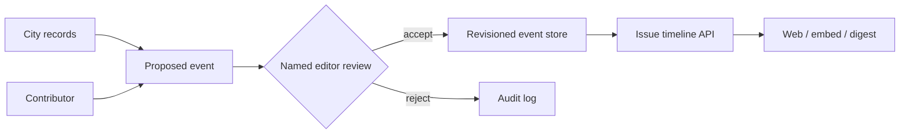

# Architecture

The demo is a static Next.js App Router export using shared JSON fixtures and deterministic TypeScript timeline assembly. FastAPI independently validates source URLs, kinds, dates, and summaries, then returns an ordered timeline with `pending_human_review`. It does not persist. Production uses Postgres with immutable event revisions, uniqueness on `(issue_id, source_url, source_span)`, an outbox for digests, object storage for permitted source snapshots, and role-based editorial authorization.

Shadow paths: empty search shows a clear empty state; invalid/short evidence is rejected; unknown issue returns named `ISSUE_NOT_FOUND`; upstream fetch errors never alter a verified timeline; duplicate submissions become review candidates rather than overwrites. Observe ingestion lag, unreviewed queue age, correction rate, broken-source rate, delivery success, and editor time per accepted event.
